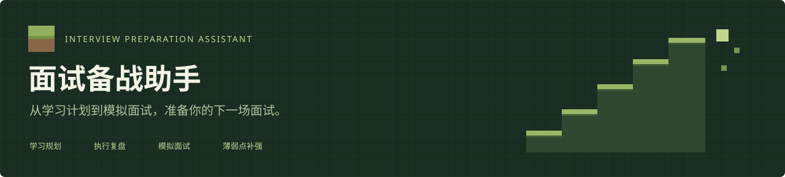
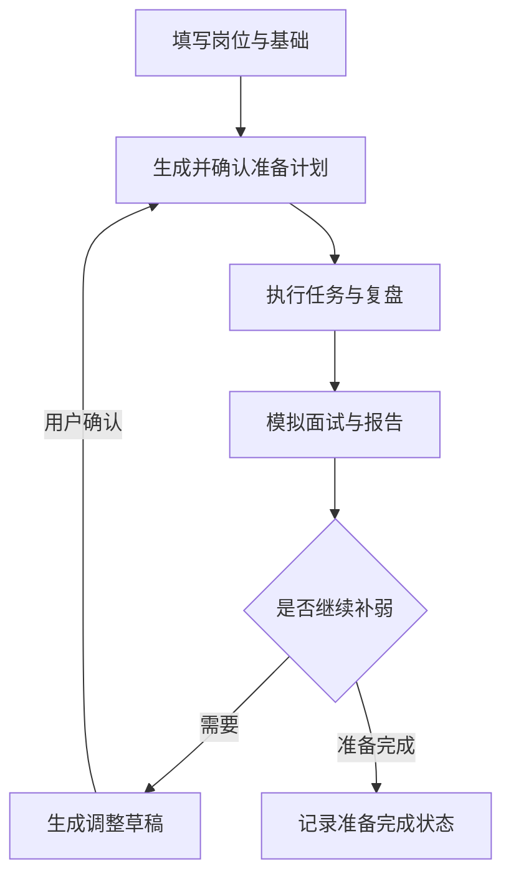

<div align="center">



# 面试备战助手

**从学习计划到模拟面试，帮你准备下一场面试。**

填写目标岗位与当前基础，生成每日任务；通过执行复盘和模拟面试发现不足，再调整后续准备。


[界面预览](#界面预览) · [核心功能](#核心功能) · [Agent 分工](#agent-与后端分工) · [快速开始](#快速开始) · [项目结构](#项目结构) · [当前边界](#当前边界)

</div>

---

## 为什么做这个项目

准备技术面试时，难点往往不只是“找资料”，而是如何把岗位要求转成可执行的任务，以及如何知道自己是否真正掌握。

| 准备中的问题 | 项目的处理方式 |
| :--- | :--- |
| 岗位要求很多，不知道从哪里开始 | 结合岗位 JD、当前基础和准备日期，生成每日任务 |
| 计划过于宽泛，做完也缺少产出 | 每项任务说明具体行动与预期产出 |
| 执行偏离原计划 | 记录完成情况、实际耗时与备注，进行执行复盘 |
| 看过知识点，却不一定能回答追问 | 进行文字模拟面试，并根据回答追问 |
| 面试发现不足后，不知道如何继续 | 将薄弱点转为后续计划草稿，确认后执行 |

**这是一个面向个人的面试准备练习项目，当前以本地单用户使用为主。**

## 界面预览

> 下方是明确标注的截图占位图，尚不是实际页面截图。替换方法见 [截图说明](docs/images/README.md)。

### 首页 · 明确准备目标

MC 风格视觉、功能说明与计划入口；提供可关闭的轻量动态效果。


### 对话工作台 · 左侧交流，右侧查看计划

流式回复与阶段提示；右侧按天展示任务，返回计划变更时显示更新摘要和任务标记。


### 面试报告 · 查看表现，安排下一步

查看逐题反馈、参考回答和薄弱点，可继续生成调整草稿。


## 核心功能

### 01 / 岗位驱动的每日计划

- 输入准备目标、目标岗位、当前基础和学习天数。
- 可补充岗位 JD、面试日期及重点准备内容。
- 每日可投入时长在各日期下选填；未填写时按天数安排，不强制填写时间预算。
- 模型输出任务内容和所属天数，不要求预测每项任务耗时。
- 后端校验任务日期与必要字段；草稿由用户确认后生效。

### 02 / 流式聊天与双栏工作台

- 聊天通过 **POST + SSE** 接收状态、文字片段和最终结果。
- **Enter 发送，Shift + Enter 换行**，中文输入法选词时不发送。
- 左侧对话与右侧计划独立滚动；手机端改为上下布局。
- 流式输出时，上滚阅读历史会暂停跟随；可点击“回到最新消息”。
- 新计划返回后，比较前后内容并展示更新摘要、更新时间及任务变化标记。
- 返回内容一致时显示“计划内容未变化”，不只依据助手文字宣称更新成功。
- 连接中断时保留已收到文字并提示未完成，不自动重发可能产生写入的请求。

> 当前流式链路主要用于聊天。计划表单、独立复盘和模拟面试仍使用各自的请求流程，不代表所有 Agent 的内部输出都已逐字展示。

### 03 / 执行记录与学习复盘

任务支持完成勾选、实际耗时和备注，保存后可重新读取。

复盘结果按“总结、执行情况、下一步调整、待补充信息”组织。复盘关注执行偏差，不将未完成任务直接归因于用户态度，也不在缺少记录时编造耗时。

### 04 / 文字模拟面试

| 设置 | 可选内容 |
| :--- | :--- |
| 面试范围 | 已完成内容 / 整个计划 / 岗位综合 |
| 面试类型 | 基础知识 / 项目深挖 / 综合面试 |
| 主问题数量 | 3 / 5 / 8 题 |
| 追问上限 | 每道主问题最多一次 |

- 根据岗位、计划与实际回答提出问题。
- 过程中不展示评分和参考答案，结束后生成中文报告。
- 报告包含总体评价、逐题反馈、回答依据、参考回答、薄弱点和评价限制。
- 回答先保存再请求模型，部分模型请求失败后可继续或重试。
- 面试与报告关联到当时的计划版本，保留独立问答记录。

### 05 / 补弱与计划版本

报告生成后提供两个选择：

- **根据薄弱点调整计划**：填写后续日期与天数，生成新版本草稿；确认前不替换正式计划。
- **我已经准备好了**：记录该次面试的准备确认状态，显示“祝你面试成功！”，不自动勾选任务。

计划列表按版本分组展示，详情中可查看历史版本及面试记录。

## 从准备到补弱



## Agent 与后端分工

| 角色 | 主要输入 | 负责内容 |
| :--- | :--- | :--- |
| 协调 Agent | 用户消息、当前计划和准备背景 | 理解需求，调用规划、复盘等工具 |
| 规划 Agent | 岗位目标、基础、日期、可选时长与反馈 | 生成按天组织的任务与预期产出 |
| 复盘 Agent | 原计划、执行记录和用户反馈 | 分析执行问题，提出调整建议 |
| 面试官 Agent | 岗位、学习内容及历史问答 | 提问与针对性追问 |
| 评估 Agent | 面试背景和完整问答 | 生成逐题反馈、薄弱点和建议 |

**模型负责内容生成与分析；代码负责状态、校验与写入。**

- Pydantic 定义结构化计划、问题与报告字段。
- 后端控制面试题数、追问上限及草稿确认规则。
- SQLAlchemy 事务管理相关数据写入。
- SQLite 保存业务数据，Agent 内存检查点单独管理对话状态。
- 表单生成计划、独立模拟面试等明确操作可直接进入对应服务，不强制每个请求都经过协调 Agent。

## 技术栈

| 层级 | 技术 |
| :--- | :--- |
| API 服务 | Python、FastAPI、Uvicorn |
| Agent 编排 | LangChain、LangGraph |
| 数据校验 | Pydantic |
| 数据访问 | SQLAlchemy、SQLite |
| 网页界面 | Vue 3、Element Plus、Axios、Fetch |
| 实时交互 | SSE 事件流 |
| 视觉风格 | MC 风格 CSS、内嵌 SVG、可关闭动效 |
| 模型接入 | 远程模型 API，配置位于 `model_config.py` |

前端使用 CDN 引入依赖，当前不需要 Node.js 构建；运行时需要能访问相关 CDN 和模型服务。

## 快速开始

### 1. 获取代码

```bash
git clone https://github.com/drewill/multi-agent.git
cd multi-agent
```

### 2. 创建环境

建议使用与开发环境一致的 **Python 3.11**。

```bash
python -m venv .venv
```

Windows PowerShell：

```powershell
.\.venv\Scripts\Activate.ps1
```

<details>
<summary>Windows CMD / Linux / macOS 激活方式</summary>

Windows CMD：

```bat
.venv\Scripts\activate.bat
```

Linux / macOS：

```bash
source .venv/bin/activate
```

</details>

### 3. 安装依赖

```bash
python -m pip install -r requirements.txt
```

### 4. 配置环境变量

复制 `.env.example` 为 `.env`，并填写真实配置。

Windows PowerShell：

```powershell
Copy-Item .env.example .env
```

Linux / macOS：

```bash
cp .env.example .env
```

```dotenv
DEEPSEEK_FLASH_KEY=your_api_key
DEEPSEEK_FLASH_URL=your_model_api_base_url
```

在 `model_config.py` 中检查模型名称及额外参数。模型服务需支持当前工具调用与结构化输出方式；API 兼容不代表所有模型能力相同。

**真实 `.env`、API Key、用户数据库及备份不要提交到 Git。**

### 5. 启动

在包含 `main.py` 的目录执行：

```bash
python -m uvicorn main:app --host 127.0.0.1 --port 8000
```

- 网页：[http://127.0.0.1:8000](http://127.0.0.1:8000)
- 接口文档：[http://127.0.0.1:8000/docs](http://127.0.0.1:8000/docs)

首次启动初始化所需数据表，当前按 **单用户、单 worker** 模式运行。

<details>
<summary>常见启动与显示问题</summary>

- **8000端口占用**：先停止旧服务，或使用 `--port 8001`，访问地址也改为8001。
- **缺少API Key**：确认 `.env` 在正确目录，且变量名称与 `model_config.py` 一致。
- **修改界面后仍显示旧版**：按 Ctrl + F5 强制刷新，确认后端返回的是 `static/index3.html`。
- **流式接口404**：前端需要配套的 `POST /api/chat/stream` 后端，单独替换HTML无法提供流式服务。
- **只看到生成建议，计划未变化**：查看工具执行结果及后端日志，不能仅根据助手文字认定已保存。

</details>

## 项目结构

```text
multi-agent/
├── agents/
│   ├── coordinator.py          # 协调、工具委派与聊天处理
│   ├── planner.py              # 规划 Agent
│   ├── revs.py                 # 复盘 Agent
│   ├── interviewer.py          # 面试官与评估 Agent
│   └── plan_service.py         # 计划校验、保存与确认
├── static/
│   └── index3.html             # Vue 界面与交互
├── docs/
│   └── images/                # README 横幅和页面截图
├── data/                      # 运行时数据，不提交用户数据库
├── main.py                    # FastAPI 路由与生命周期
├── model_config.py            # 模型配置
├── schemas.py                 # 结构化输入输出与校验
├── datasets.py                # 数据库配置与业务表
├── repository.py              # 数据读写与序列化
├── task_allocation.py          # 任务按天分组与校验
├── migrate_daily_plans.py      # 数据库升级兼容
├── plan_form_routes.py         # 计划表单接口
├── interview_models.py         # 面试、问答和报告表
├── interview_service.py        # 面试状态与报告、补弱服务
├── interview_routes.py         # 模拟面试接口
├── .env.example
├── .gitignore
├── requirements.txt
└── README.md
```

## 验证与问题记录

功能验收与 AI 内容质量分别检查：

| 检查方向 | 关注内容 |
| :--- | :--- |
| 业务功能 | 数据保存、草稿确认、题数与追问限制、报告恢复、版本切换 |
| 交互体验 | Enter发送、输入法保护、流式阅读、计划变化提示、按钮可读性 |
| 异常恢复 | 模型失败、连接中断、重复操作、服务重启 |
| 内容质量 | 任务是否符合基础、追问是否相关、报告是否引用真实回答依据 |

验收报告建议保存为 `docs/acceptance-report.md`，记录测试环境、代码版本、实际结果与复测过程。只将真正执行过的用例计入通过项。

<!-- 验收报告上传后，可以取消下面这行注释。 -->
<!-- 详细记录：[功能验收报告](docs/acceptance-report.md) -->

> “确认前修改草稿被拒绝、Agent反复确认”等问题需要同时检查工具能力和后端状态规则。是否已修复，应以当前代码及实际复测为准；本README不将待验证修复写成已通过。

## 当前边界

- 当前是本地练习项目，尚未提供完整的登录鉴权与多用户数据隔离；`conversation_id` 不等同于身份认证。
- 存在全局操作锁，模型请求可能阻塞其他受锁保护的操作，尚未按多人并发优化。
- 内存检查点重启后可能丢失；数据库业务记录保留不等于Agent完整对话状态可恢复。
- 流式读取中断不等于取消后端执行；不要自动重复提交可能修改计划的请求。
- 模型输出与面试评价需人工核对，不能替代真实面试判断或保证录用。
- 每日时长是任务量参考，不保证实际耗时，也不涉及模型参数训练或“模型自我学习”。
- API 调用产生的费用按模型服务商规则计算；公开部署前需要鉴权、限流和调用额度控制。

## 后续方向

- [ ] 完善草稿局部编辑与相关回归验收
- [ ] 登录鉴权与用户数据隔离
- [ ] 多模型选择与能力校验
- [ ] 持久化对话状态与异常恢复
- [ ] 调用限额、耗时与费用统计
- [ ] 语音面试与更完善的评价依据
- [ ] 并发处理、后台任务及部署配置

---

<div align="center">

**每天准备一点，让下一次回答更有依据。**

学习规划 · 执行复盘 · 模拟面试 · 薄弱点补强

</div>
